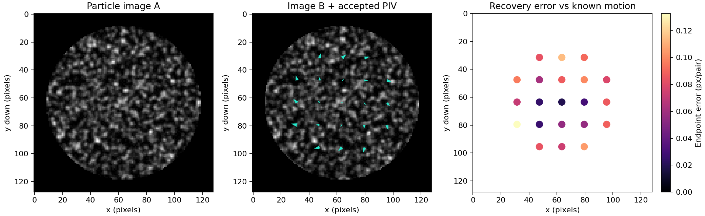
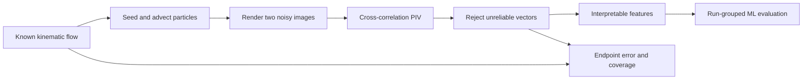

# DropletFlowLab

**Particle Image Velocimetry and Machine Learning for Droplet Flow Analysis**

A reproducible framework for measuring particle displacement and classifying flow patterns in droplet images. The pipeline combines synthetic image generation, cross-correlation PIV, interpretable velocity features, and evaluation on independent droplet runs.

The current benchmark uses synthetic images with known displacement fields. The generator represents prescribed kinematic patterns; it does not solve the coupled evaporation and fluid-flow equations. A separate image-pair interface supports calibrated PIV analysis of experimental images.



## Research question

Can interpretable features extracted from PIV distinguish radial, circulating, and mixed **synthetic patterns**, and how does image noise affect reliability?

Evaluation separates measurement quality from classification performance: endpoint error and vector coverage quantify PIV recovery, while balanced accuracy and macro-F1 quantify pattern recognition. Complete droplet runs are held out to prevent shared acquisition parameters from leaking across the split. A majority-class baseline and an independent noise-shift dataset provide reference comparisons.

## Run it

Python 3.10+; commands below are for Windows PowerShell from the repository folder.

```powershell
python -m venv .venv
.\.venv\Scripts\python -m pip install -e ".[dev,dashboard]"
.\.venv\Scripts\python -m droplet_lab.cli demo --regime mixed
.\.venv\Scripts\python -m droplet_lab.cli benchmark --runs 12 --frames 3
.\.venv\Scripts\python -m streamlit run app.py
.\.venv\Scripts\python -m pytest -q
```

On macOS/Linux use `.venv/bin/python`. With the environment activated, `droplet-lab demo` and `droplet-lab benchmark` are equivalent CLI commands. `requirements-lock.txt` records the exact locally tested package versions; use it to recreate that environment before installing this package with `--no-deps -e .`.

## What is included

| Component | Method / output |
|---|---|
| Particle-image generator | Seeding, subpixel motion, optical blur, image noise, masks |
| Transparent single-pass PIV | Linear FFT cross-correlation, peak search, subpixel fit, peak-ratio rejection |
| Ground-truth benchmark | Endpoint error **and** accepted-vector coverage |
| Interpretable features | Radial/tangential motion, speed variation, coverage |
| Random forest + majority baseline | Grouped holdout, balanced accuracy, macro-F1, confusion matrix |
| Independent noisy runs | Evaluation under an image-noise distribution shift |
| Streamlit dashboard | Image-quality and interrogation-window parameter controls |
| Real image-pair CLI | Masking, calibration, vector CSV, confidence plot |
| Scientific tests + CI | Displacement sign, subpixel accuracy, no-motion and no-signal cases |

## Pipeline



## Results and reproducibility

The reference run contains 108 image pairs from 36 synthetic runs, with 27 runs used for training and 9 held out. Mean PIV endpoint error is **0.0863 pixels/pair**, increasing to **0.1956 pixels/pair** under the noise shift. All eligible vectors are accepted in both settings. The classifier reaches **100% balanced accuracy** on these prescribed patterns, compared with **33.3%** for the majority baseline. The unchanged classification score despite higher displacement error illustrates why both stages require independent evaluation. These results do not establish performance on experimental data.

See [the measured benchmark](reports/RESULTS.md), [metrics JSON](reports/benchmark/metrics.json), and [benchmark chart](reports/benchmark/benchmark.png). Rerun with seed 42 to reproduce the committed example; floating-point/library differences may cause small changes. `outputs/` is ignored, while `reports/` contains the deliberately retained example results.

The split holds out complete run IDs within each class. Frames from the same run share amplitude, particle count, blur, noise level and circulation direction. Only age and particle realization vary. Test data do not select model hyperparameters. Noise-shift data use a different seed and are never used for training.

## Experimental image analysis

```powershell
.\.venv\Scripts\python -m droplet_lab.cli piv frame_a.tif frame_b.tif --mask mask.png --microns-per-pixel 1.2 --dt 0.02
```

Use single grayscale image files of equal size. A nonzero mask pixel marks droplet interior. Without a mask all windows are eligible; this is usually inappropriate if the image includes substrate/background. The implementation reads one image plane, not a multipage TIFF sequence. It does not perform camera calibration, lens correction, image registration, or automatic segmentation.

CSV columns are `x_px,y_px,u,v,peak_ratio,eligible,valid`; the experimental command writes velocity in **micrometres/second**, and demo writes **pixels/pair**. Plot arrows always show pixels/pair. Coordinates use **x right, y down**. Invalid velocities remain NaN. Metadata records units and calibration. Keep unpublished lab data out of Git (`data/raw/` is ignored).

**The synthetic classifier is intentionally not applied to real lab images.** Similar-looking patterns do not establish the physical driving mechanism. Use labeled experimental runs and independent validation before making such claims.

## Technical documentation

- [Physics, equations, and assumptions](docs/SCIENCE.md)
- [Experimental data and validation protocol](docs/EXPERIMENTAL_PROTOCOL.md)

## Scientific foundations

The physical motivation is outward replenishment flow associated with pinned evaporating drops ([Deegan et al., 1997](https://www.nature.com/articles/39827)). The image-pair measurement approach follows established cross-correlation PIV principles described in [OpenPIV's PIV basics](https://openpiv.readthedocs.io/en/stable/src/piv_basics.html); this repository implements its own single-pass estimator. Competing flow mechanisms in binary droplets are discussed by [Diddens et al., competing Marangoni and Rayleigh convection](https://www.cambridge.org/core/journals/journal-of-fluid-mechanics/article/competing-marangoni-and-rayleigh-convection-in-evaporating-binary-droplets/67AEC6D85935B52BB15E85CE6D48180B).
