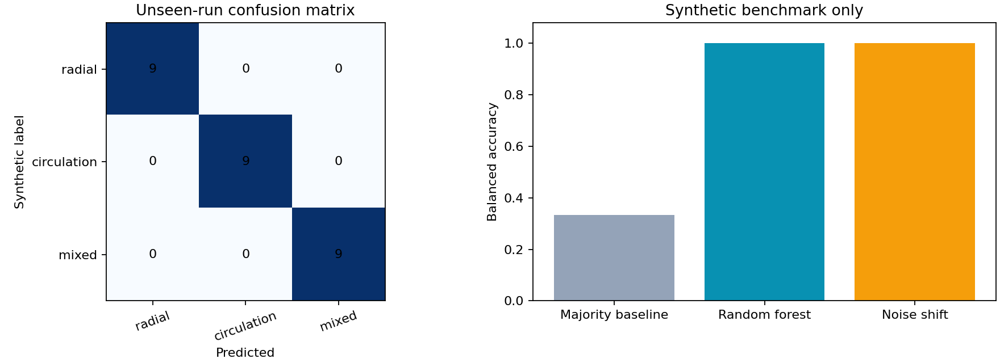

# Reproduced example results

Generated with Python 3.10.11, seed 42, 12 independent runs per synthetic class and 3 image pairs per run. Exact installed versions are recorded in `requirements-lock.txt`.

```powershell
.\.venv\Scripts\python -m droplet_lab.cli demo --output reports/demo
.\.venv\Scripts\python -m droplet_lab.cli benchmark --runs 12 --frames 3 --seed 42 --output reports/benchmark
```

| Measurement | Result |
|---|---:|
| Synthetic image pairs | 108 |
| Training / held-out runs | 27 / 9 |
| Shared runs between train and test | 0 |
| Majority baseline balanced accuracy | 33.3% |
| Random forest held-out balanced accuracy | 100% |
| Random forest held-out macro-F1 | 1.00 |
| Mean PIV endpoint error, all normal-noise pairs | 0.0863 pixels/pair |
| Mean PIV endpoint error, held-out normal-noise pairs | 0.0866 pixels/pair |
| Accepted fraction of eligible vectors | 100% |
| Independent noise-shift balanced accuracy | 100% |
| Noise-shift mean PIV endpoint error | 0.1956 pixels/pair |
| Noise-shift accepted fraction | 100% |

The noise-shift evaluation uses 12 newly generated runs / 36 pairs and image-noise sigma 0.10, compared with 0.01–0.045 in the main dataset. It more than doubles PIV error without changing classification accuracy. These patterns are deliberately easy to separate: high classification accuracy can hide degraded velocity estimates.

The bootstrap interval is [1.00, 1.00] because all nine held-out runs are correctly classified. With this small, easy synthetic dataset, that is not compelling evidence of broader generalization. Neither the interval nor the test accuracy includes simulator mismatch, real camera effects, or physical-model uncertainty.

100% coverage refers to windows that pass the 85%-interior mask criterion, **not** the entire droplet or image. Boundary windows are excluded. Errors compare PIV displacement to center-sampled ground truth and are computed only on accepted vectors.



Machine-readable results: `benchmark/metrics.json`. The NPZ dataset contains features, labels, run IDs, split indices, errors and coverage for audit. Example image pairs, truth arrays, vectors and metadata are in `demo/`.
